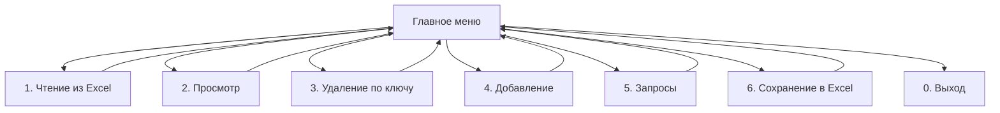

# Старков Владимир ИТ-6 Группа Лабораторная №5

# Задание 1

## Задача 1

### Текст задачи

**Тема:** LINQ-запросы. Вариант 14.

Разработать консольное приложение с дружественным интерфейсом с возможностью выбора заданий. Приложение должно выполнять следующие функции:

1. Чтение базы данных из Excel-файла.
2. Просмотр базы данных.
3. Удаление элементов (по ключу).
4. Добавление элементов.
5. Реализация 4 запросов (формулировки придумать самостоятельно):
   1. 1 запрос с обращением к одной таблице;
   2. 1 запрос с обращением к двум таблицам;
   3. 2 запроса с обращением к трём таблицам.

   Два запроса должны возвращать перечень, два запроса – одно значение.
6. Сохранение изменений в Excel-файле.

Элементами базы данных являются объекты классов согласно варианту. Содержание классов определить самостоятельно (в классах должны присутствовать свойства, конструкторы, перегруженный метод `ToString`). Весь функционал приложения реализовать в виде методов вспомогательного класса с помощью LINQ-запросов. Предусмотреть обработку возможных ошибок при работе программы.

**Вариант 14.** В файле `LR5-var14.xls` приведён фрагмент базы данных «Фильмы». Таблица «Фильмы» содержит информацию о названии фильма, продолжительности фильма в секундах, бюджете фильма (в долларах) и о сборах с его показа (в долларах). Таблица «Режиссёры» содержит информацию о режиссёре, а таблица «Жанры» – жанрах, к которым могут относиться фильмы. Поле ID в каждой таблице обозначает код объекта.

Схема базы данных:

| Таблица | Поля |
|---|---|
| **Фильмы** | **ID**, Название фильма, ID режиссёра, Год выхода, ID жанра, Продолжительность, Бюджет, Сборы |
| **Режиссёры** | **ID**, Имя режиссёра, Страна происхождения |
| **Жанры** | **ID**, Название |

Связи: `Фильмы.ID режиссёра → Режиссёры.ID`, `Фильмы.ID жанра → Жанры.ID`.

Пример запроса из задания:
> Определите долю (в процентах) фильмов, снятых в СССР, среди всех фильмов, снятых с 1920 года по 1960 год (включительно) с бюджетом меньше $1000000. В ответ запишите только целую часть числа.
>
> Ответ: 38

### Алгоритм решения

#### Структура проекта

| Файл | Назначение |
|---|---|
| `Models.cs` | Классы `Film`, `Director`, `Genre`, контейнер `FilmDatabase` |
| `ExcelRepository.cs` | Чтение и запись Excel-файла (библиотека NPOI, форматы `.xls` и `.xlsx`) |
| `FilmService.cs` | Вспомогательный класс: добавление, удаление и запросы на LINQ |
| `Program.cs` | Консольное меню, ввод данных и обработка ошибок |

#### Классы базы данных

Каждая таблица представлена своим классом. В классах есть автоматические свойства, конструктор без параметров, конструктор с параметрами и переопределённый метод `ToString`.

| Класс | Свойства |
|---|---|
| `Film` | `Id`, `Title`, `DirectorId`, `Year`, `GenreId`, `DurationSeconds`, `Budget`, `Revenue` |
| `Director` | `Id`, `Name`, `Country` |
| `Genre` | `Id`, `Name` |

Класс `FilmDatabase` хранит три коллекции: `List<Film> Films`, `List<Director> Directors`, `List<Genre> Genres`.

#### Работа программы



1. **Чтение (п. 1).** `ExcelRepository.Load` читает файл в память и находит листы «Фильмы», «Режиссёры», «Жанры» (если имена не совпали, берутся листы 1, 2, 3 по порядку). Строки со второй до последней преобразуются в объекты LINQ-цепочкой `Enumerable.Range(...).Select(sheet.GetRow).Where(...).Select(factory).ToList()`. Пустые строки пропускаются.
2. **Просмотр (п. 2).** Пользователь выбирает таблицу, элементы выводятся через `ToString`.
3. **Удаление (п. 3).** Пользователь выбирает таблицу и вводит ключ. Удаление выполняется методом `RemoveAll(x => x.Id == id)`. Режиссёра или жанра нельзя удалить, пока на них ссылаются фильмы (проверка `Any`), иначе выбрасывается `InvalidOperationException`.
4. **Добавление (п. 4).** Пользователь выбирает таблицу и вводит поля. Перед добавлением проверяется уникальность ключа (`Any`), существование режиссёра и жанра для фильма, корректность значений (непустое название, положительная продолжительность, неотрицательные бюджет и сборы).
5. **Запросы (п. 5).** Описаны ниже.
6. **Сохранение (п. 6).** `ExcelRepository.Save` создаёт книгу с тремя листами и записывает в неё содержимое коллекций. Формат определяется по расширению файла (`.xls` или `.xlsx`).

#### Запросы

**Запрос 1. Одна таблица, возвращает значение.**
Определить суммарные сборы фильмов, вышедших в заданный период, с бюджетом меньше заданного.

```csharp
public static decimal GetTotalRevenue(FilmDatabase db, int yearFrom, int yearTo, decimal maxBudget) =>
    db.Films
        .Where(f => f.Year >= yearFrom && f.Year <= yearTo && f.Budget < maxBudget)
        .Sum(f => f.Revenue);
```

**Запрос 2. Две таблицы, возвращает перечень.**
Вывести фильмы режиссёров заданной страны с указанием режиссёра, по возрастанию года выхода.

```csharp
public static IEnumerable<string> GetFilmsByDirectorCountry(FilmDatabase db, string country) =>
    db.Films
        .Join(
            db.Directors,
            film => film.DirectorId,
            director => director.Id,
            (film, director) => new { film.Title, film.Year, Director = director.Name, director.Country })
        .Where(x => x.Country.Equals(country, StringComparison.OrdinalIgnoreCase))
        .OrderBy(x => x.Year)
        .ThenBy(x => x.Title)
        .Select(x => $"{x.Year} | {x.Title,-35} | {x.Director}");
```

**Запрос 3. Три таблицы, возвращает значение.**
Определить долю (в процентах, целая часть) фильмов режиссёров заданной страны среди фильмов заданного жанра (если жанр не указан, учитываются все жанры), снятых в заданный период с бюджетом меньше заданного. При пустом жанре, стране «СССР», периоде 1920–1960 и бюджете 1000000 запрос воспроизводит пример из задания.

```csharp
var films = db.Films
    .Where(f => f.Year >= yearFrom && f.Year <= yearTo && f.Budget < maxBudget)
    .Join(db.Directors, f => f.DirectorId, d => d.Id, (f, d) => new { Film = f, d.Country })
    .Join(db.Genres, x => x.Film.GenreId, g => g.Id,
        (x, g) => new { x.Film, x.Country, GenreName = g.Name })
    .Where(x => string.IsNullOrWhiteSpace(genreName)
        || x.GenreName.Equals(genreName, StringComparison.OrdinalIgnoreCase))
    .ToList();

int matching = films.Count(x => x.Country.Equals(country, StringComparison.OrdinalIgnoreCase));
return (int)(matching * 100L / films.Count);
```

Если подходящих фильмов нет, выбрасывается `InvalidOperationException`, чтобы избежать деления на ноль.

**Запрос 4. Три таблицы, возвращает перечень.**
По каждому жанру вывести число фильмов режиссёров заданной страны и их суммарную прибыль (сборы минус бюджет), по убыванию прибыли.

```csharp
db.Films
    .Join(db.Directors, f => f.DirectorId, d => d.Id, (f, d) => new { Film = f, d.Country })
    .Where(x => x.Country.Equals(country, StringComparison.OrdinalIgnoreCase))
    .Join(db.Genres, x => x.Film.GenreId, g => g.Id, (x, g) => new { x.Film, GenreName = g.Name })
    .GroupBy(x => x.GenreName)
    .Select(group => new
    {
        Genre = group.Key,
        Count = group.Count(),
        Profit = group.Sum(x => x.Film.Revenue - x.Film.Budget),
    })
    .OrderByDescending(x => x.Profit)
    .Select(x => $"{x.Genre,-25} | фильмов: {x.Count,3} | прибыль: {x.Profit,14:N0} $");
```

| Запрос | Таблицы | Результат |
|---|---|---|
| 1 | Фильмы | значение |
| 2 | Фильмы, Режиссёры | перечень |
| 3 | Фильмы, Режиссёры, Жанры | значение |
| 4 | Фильмы, Режиссёры, Жанры | перечень |

#### Обработка ошибок

| Ситуация | Реакция программы |
|---|---|
| Файл не найден | `FileNotFoundException`, сообщение об ошибке, возврат в меню |
| В файле нет нужного листа | `InvalidDataException`, сообщение об ошибке |
| Файл повреждён или занят другой программой | `IOException` / `UnauthorizedAccessException`, сообщение об ошибке |
| Операция до загрузки базы | Сообщение «База данных не загружена» |
| Ввод нечислового значения | Повторный запрос ввода |
| Пустая строка вместо текста | Повторный запрос ввода |
| Повторяющийся ключ при добавлении | `ArgumentException`, элемент не добавляется |
| Несуществующий режиссёр или жанр у нового фильма | `ArgumentException`, фильм не добавляется |
| Удаление записи, на которую есть ссылки | `InvalidOperationException`, запись не удаляется |
| Удаление несуществующего ключа | Сообщение «Элемент с таким ключом не найден» |
| Запрос 3 без подходящих фильмов | `InvalidOperationException`, сообщение вместо деления на ноль |

### Тестирование


**1. Чтение базы данных (п. 1)**


**2. Просмотр таблиц (п. 2)**


**3. Удаление элемента по ключу (п. 3)**

Успешное удаление, несуществующий ключ.


**4. Добавление элемента (п. 4)**

Успешное добавление и отказ при дублирующемся ключе.


**5. Запросы (п. 5)**

Запрос 1. Параметры: 1920, 1960, 1000000.


Запрос 2. Параметр: страна «СССР».


Запрос 3. Параметры: страна «СССР», жанр пустой, 1920, 1960, 1000000. Ожидаемый результат для файла из задания: **38 %**.


Запрос 4. Параметр: страна «СССР».


**6. Сохранение изменений (п. 6)**

Видно на других скриншотах.

**7. Обработка ошибок**

Операция до загрузки базы, ввод буквы вместо числа, отсутствующий файл.


